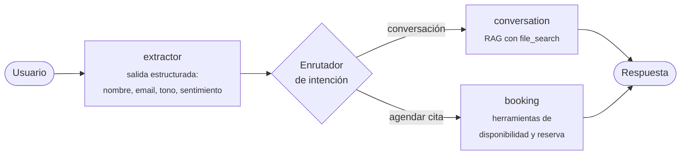

<div align="center">

# 🤖 Agentes de IA con LangGraph

**Colección de agentes y patrones agénticos construidos con LangGraph, servidos con FastAPI.**


</div>

---

## ✨ Qué incluye

Cada agente es un grafo registrado en [`langgraph.json`](langgraph.json), así que todos se pueden probar desde LangGraph Studio.

| Grafo | Patrón | Qué hace |
| --- | --- | --- |
| `support` | Enrutamiento + RAG + herramientas | Agente de atención: extrae los datos del cliente, detecta la intención y responde con RAG o agenda citas médicas. |
| `react_agent` | ReAct | Asistente de ventas que consulta productos de una API y el clima de una ciudad. |
| `code_review` | Paralelización | Revisa código en paralelo (seguridad, mantenibilidad y rendimiento) y consolida un informe final. |
| `orchestartor` | Orquestador-trabajadores | Reparte trabajo dinámicamente entre nodos con `Send` y agrega los resultados. |
| `evaluator` | Evaluador-optimizador | Genera una respuesta, la evalúa con salida estructurada y la mejora hasta cumplir el criterio. |
| `rag` | RAG | Conversación con búsqueda en un *vector store* de OpenAI (`file_search`). |
| `simple` / `agent` | Básicos | Grafos de introducción a estados, nodos y herramientas. |

## 🧭 Arquitectura del agente de soporte



- **Estado compartido** (`MessagesState`): historial de mensajes y datos del cliente.
- **Enrutador**: un LLM con salida estructurada (Pydantic) decide el siguiente nodo.
- **Herramientas**: consulta de disponibilidad y reserva de citas (`@tool`).

## 🌐 API

La API en [`src/api/main.py`](src/api/main.py) expone el agente de soporte:

| Método | Ruta | Descripción |
| --- | --- | --- |
| `POST` | `/chat/{chat_id}` | Respuesta completa. `chat_id` se usa como `thread_id` de la conversación. |
| `POST` | `/chat/{chat_id}/stream` | Respuesta en *streaming* con Server-Sent Events. |

```bash
curl -X POST http://127.0.0.1:8000/chat/demo \
  -H "Content-Type: application/json" \
  -d '{"message": "Hola, quiero agendar una cita con el doctor el lunes a las 10"}'
```

## ⚡ Inicio rápido

**Requisitos:** Python 3.12+, [uv](https://docs.astral.sh/uv/) y una API key de OpenAI.

```bash
# 1. Instalar dependencias
uv sync

# 2. Configurar variables de entorno
echo "OPENAI_API_KEY=tu_api_key" > .env

# 3. Abrir LangGraph Studio con todos los grafos
uv run langgraph dev

# 4. (Opcional) Levantar la API
uv run fastapi dev ./src/api/main.py
```

> [!NOTE]
> El archivo [`docker-compose.yml`](docker-compose.yml) levanta un PostgreSQL para persistir el estado de las conversaciones con `langgraph-checkpoint-postgres`.

## 📁 Estructura

```text
├── src/
│   ├── agents/
│   │   ├── support/          # Agente de soporte y patrones avanzados
│   │   │   ├── nodes/        # extractor, conversation, booking
│   │   │   ├── routes/       # enrutamiento por intención
│   │   │   ├── react.py      # agente ReAct
│   │   │   ├── code_review.py
│   │   │   ├── orchestrator.py
│   │   │   └── evaluator.py
│   │   ├── rag.py
│   │   └── simple.py
│   └── api/main.py           # FastAPI
├── notebooks/                # Ruta de aprendizaje paso a paso
├── langgraph.json            # Registro de grafos
└── docker-compose.yml        # PostgreSQL para checkpoints
```

## 📓 Ruta de aprendizaje

Los [notebooks](notebooks/) documentan el proceso, del concepto al agente:

`01` Introducción · `02` Grafo simple · `03` Mensajes · `04` LLMs · `05` RAG · `06` *Chaining* · `07` Salida estructurada · `09` *Prompting* · `10` Herramientas · `11` Condiciones · `12` Paralelización · `13` Aleatoriedad

## 👤 Autor

**Jose Manuel Rengifo Correa** · AI Engineer
[LinkedIn](https://www.linkedin.com/in/jose-manuel-rengifo/) · [GitHub](https://github.com/joem9819)

## 📄 Licencia

Distribuido bajo la licencia MIT. Consulta [`LICENSE`](LICENSE).
